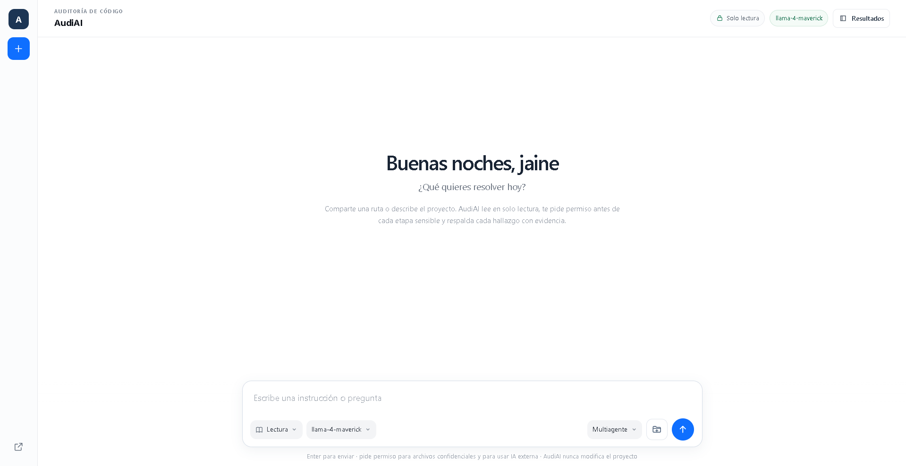
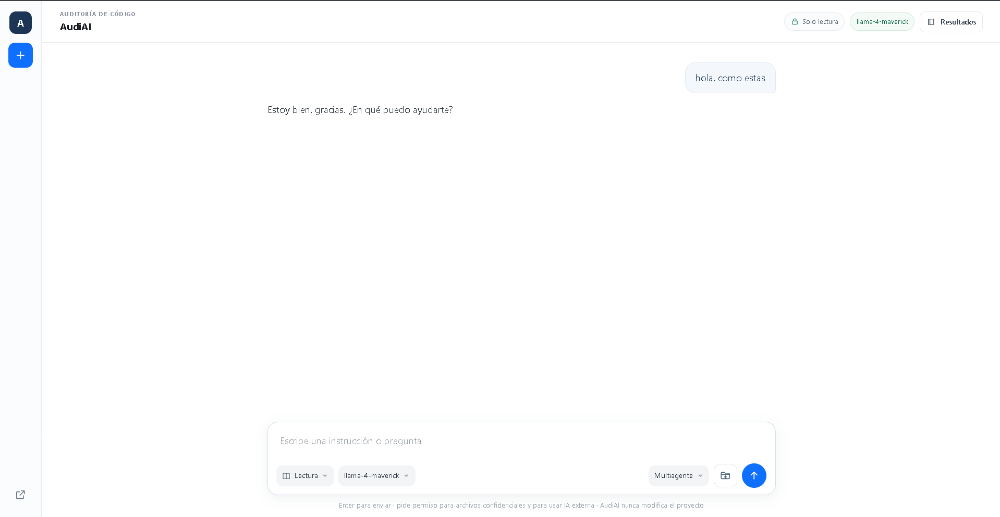
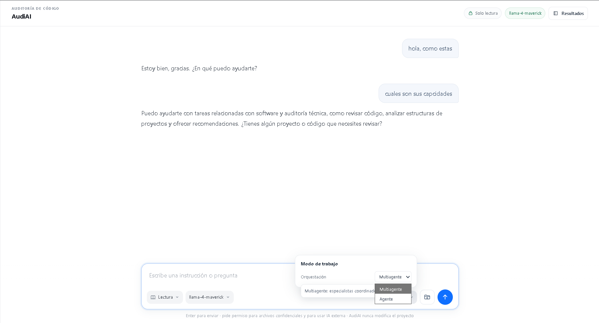
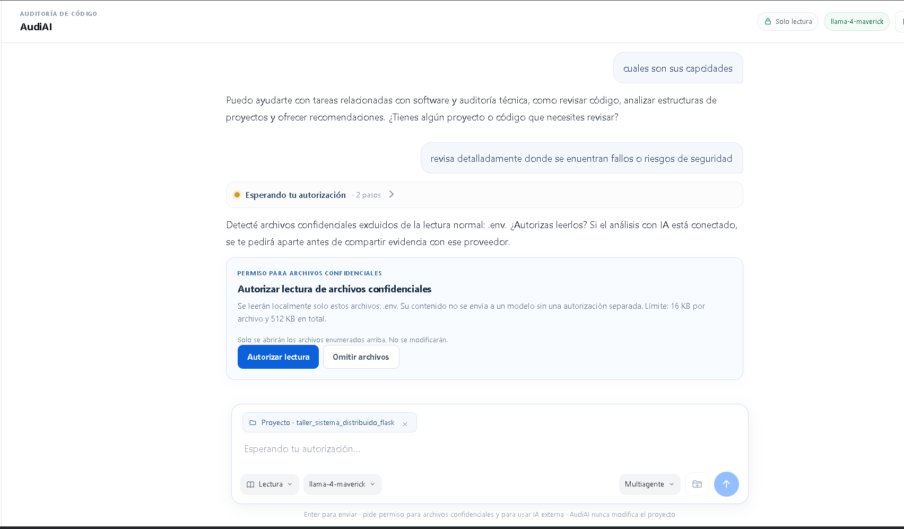
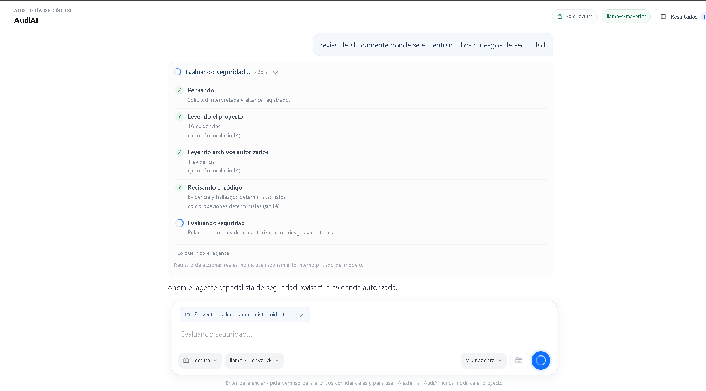
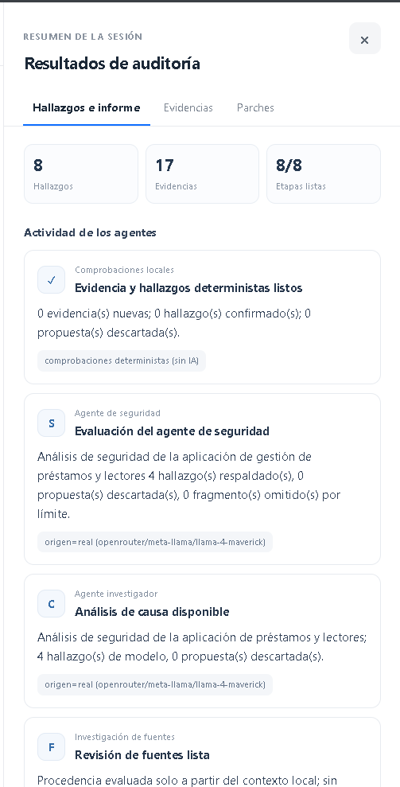
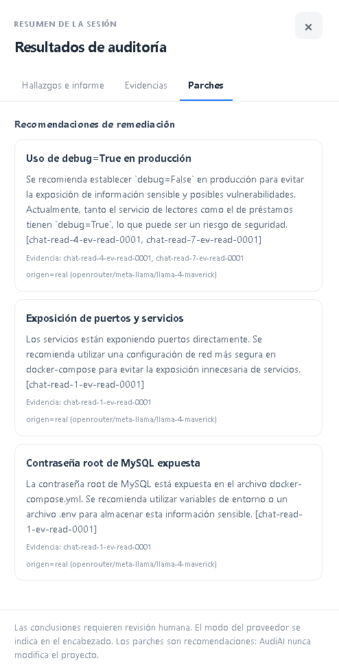

# AudiAI

Asistente de escritorio para revisar proyectos de software autorizados. AudiAI
recopila evidencia mediante lecturas acotadas y comprobaciones deterministas,
y puede utilizar modelos de lenguaje para ayudar a analizar los resultados.

> **Estado del proyecto:** AudiAI está en desarrollo. Sus resultados son
> orientativos y requieren revisión humana; no constituyen una auditoría
> exhaustiva ni una garantía de seguridad.

## Funcionalidades

- Interfaz de chat con modos **Agente** y **Multiagente**.
- Selección de una carpeta autorizada como contexto para la revisión.
- Comprobaciones deterministas y análisis de evidencia con un proveedor
  configurable.
- Informe descargable en Markdown con hallazgos, recomendaciones, fuentes y
  limitaciones.
- Aplicación de escritorio para Windows con selector nativo de carpetas.

Consulta la [guía de uso](docs/README.md) para conocer los modos de análisis,
los informes y cómo adjuntar un proyecto como contexto.

## Interfaz

### Pantalla de inicio



### Conversación con AudiAI



### Selección del modo de análisis



### Autorización para leer archivos confidenciales



### Análisis en curso



### Resultados de auditoría



### Recomendaciones de remediación



## Privacidad y límites

- El análisis se limita a la carpeta seleccionada y es de solo lectura.
- Archivos que pueden contener secretos se excluyen por defecto. Leerlos
  requiere autorización explícita.
- El proveedor predeterminado es `mock`; las respuestas simuladas no equivalen
  a un análisis de un modelo real.
- LM Studio permite ejecutar el análisis con un modelo local. Un proveedor
  externo solo debe habilitarse con autorización para compartir la evidencia.
- Las comprobaciones y respuestas del modelo pueden producir falsos positivos
  o pasar por alto problemas. Revisa los hallazgos antes de tomar decisiones.

AudiAI no ejecuta el código del proyecto analizado ni aplica automáticamente
los parches sugeridos.

## Requisitos

- Windows
- Python y `pip`
- Para la aplicación de escritorio, Microsoft Edge WebView2 Runtime
- Para análisis local con IA, LM Studio con un modelo cargado y su servidor
  compatible con OpenAI habilitado

## Instalación

Desde la raíz del repositorio, crea un entorno virtual e instala las
dependencias:

```powershell
python -m venv .venv
.\.venv\Scripts\python.exe -m pip install -r backend\requirements.txt
if (-not (Test-Path .env)) { Copy-Item .env.example .env }
```

Edita `.env` en la raíz del repositorio para configurar el proveedor. El archivo
real está excluido de Git; no publiques ni compartas la clave de API.

## Ejecución

### Aplicación de escritorio

```powershell
Set-Location backend
..\.venv\Scripts\python.exe -m app.desktop
```

### Servidor local

```powershell
Set-Location backend
..\.venv\Scripts\python.exe -m app
```

El servidor se inicia en `http://127.0.0.1:8000`. La comprobación de salud está
disponible en `http://127.0.0.1:8000/health`.

### Pruebas

Desde la raíz del repositorio:

```powershell
Set-Location backend
..\.venv\Scripts\python.exe -m pytest
```

## Proveedores de modelos

El proveedor se selecciona mediante la variable de entorno
`AUDIAI_ROLE_PROVIDER`. Los valores disponibles son `mock` (predeterminado),
`lmstudio`, `openrouter` y `strands`.

### OpenRouter

En `.env`, establece el proveedor y completa el identificador de un modelo
disponible en tu cuenta de OpenRouter y tu clave API:

```dotenv
AUDIAI_ROLE_PROVIDER=openrouter
OPENROUTER_MODEL=proveedor/modelo
OPENROUTER_API_KEY=tu_clave_de_openrouter
```

Inicia AudiAI desde la raíz con `.\.venv\Scripts\python.exe -m app` después de
entrar en `backend`. Antes de enviar evidencia, la interfaz solicita
autorización explícita. El servicio transmite el contexto autorizado a
OpenRouter; el costo y la disponibilidad dependen del modelo y de la cuenta.
No se realiza una llamada real hasta que configures credenciales y autorices
el envío en la aplicación.

Para usar LM Studio en PowerShell, configura el proveedor en la misma terminal
desde la que inicies AudiAI:

```powershell
$env:AUDIAI_ROLE_PROVIDER = "lmstudio"
$env:AUDIAI_LMSTUDIO_BASE_URL = "http://127.0.0.1:1234/v1"
Set-Location backend
..\.venv\Scripts\python.exe -m app
```

Opcionalmente, configura `AUDIAI_LMSTUDIO_MODEL` para elegir un modelo concreto
y `AUDIAI_LMSTUDIO_API_KEY` si el servidor local la requiere. La clave se lee
desde el entorno y no se devuelve a la interfaz. AudiAI solo acepta direcciones
loopback para LM Studio.

El modo `strands` puede enviar evidencia a un proveedor externo. No lo habilites
sin revisar y autorizar previamente qué información se compartirá y las
condiciones del proveedor.

## Estructura del repositorio

```text
backend/
  app/       Aplicación, API, interfaz y lógica de análisis
  tests/     Pruebas automatizadas
docs/        Documentación para usuarios
```

## Licencia

AudiAI se distribuye bajo la licencia [GNU GPL-3.0](LICENSE). Las copias
distribuidas y las versiones modificadas deben cumplir sus condiciones,
incluidas las obligaciones aplicables de conservar la licencia y proporcionar
el código fuente correspondiente. La GPL-3.0 no obliga a publicar cambios que
no se distribuyan ni a enviar contribuciones al proyecto original. La licencia
no concede derechos sobre la marca AudiAI.

## Autor y mantenimiento

Creador y mantenedor: Jainer Yohany Chocue Viluche.

Repositorio original: https://github.com/jainerchocue/audiai
